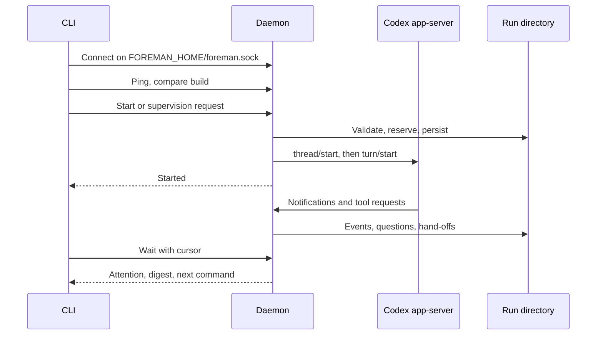

# foreman 0.1.0 architecture

foreman keeps supervision in a local daemon so a coding turn can outlive the CLI call that started it. The daemon owns run state and one shared Codex app-server child. The CLI resolves inputs and renders results; it does not own the lifetime of a turn.

The [RFC](rfcs/0001-foreman.md) records the original plan and build history. Contributor commands and area-specific rules live in [AGENTS.md](../AGENTS.md).

## Processes and request flow

The socket protocol is newline-delimited JSON with request ids. `src/schemas/daemon.ts` defines requests, results and persisted run shapes. `src/schemas/codex.ts` describes the app-server messages foreman consumes. Schema decoding at these boundaries keeps transport details out of command programs.

`bin.ts` supplies Bun platform services and process writers. `main.ts` runs the command tree in `cli.ts`, maps errors to exit codes and renders output once. Handlers in `commands/` call `core/commands.ts`, which resolves paths and message files before calling the daemon client. Results go through Output; stdout contains one result, and diagnostics go to stderr. The same programs run under Node services in tests.

The daemon starts the app server lazily when a request needs it. Runs use separate persistent Codex threads in the shared child, routed by thread id. This saves a process per run, but an app-server failure can lose supervision for every active run on that connection. The next request needing Codex starts a new child; an inactive run can resume its saved thread. It needs both a thread id and an existing worktree. Resume does not recreate the thread's dynamic question tool, so question delivery on resumed threads depends on Codex retaining it.

Protocol compatibility uses the recorded Codex 0.166.0 schema hash, not a version-number comparison. A failed check or mismatch adds a warning to new runs; it does not itself refuse start. Replies that fail decoding still fail the request. The client gives `thread/start` 180 seconds for MCP startup, and other requests 30 seconds by default. Global Codex MCP servers remain enabled.

## Daemon ownership and replacement

`daemon/client.ts` connects to the home socket and spawns a detached copy of the current executable if the socket is absent or refused. Startup is bounded to 10 seconds. The daemon's working directory is the home, so removing the worktree that launched it does not break later child starts. Home permissions are tightened to `0700`; the Unix socket path is limited to 104 bytes.

Only one daemon may own a home. `daemon/lock.ts` holds an exclusive SQLite transaction in `daemon.guard.sqlite` as an OS advisory lock. The database stores no application data and stays on disk: deleting it could let contenders lock different inodes. `daemon.lock` records the owner's PID for diagnostics; ownership comes from the advisory lock. The owner removes the socket and PID file only after its workers have joined, while it still holds the advisory lock. This requires a local filesystem with working locks.

The daemon exits after 30 minutes with no busy runs and no open client connections. Active states, preflight worktree reservations and queued answers count as busy. Explicit shutdown refuses while any of those need ownership. A long wait connection keeps the daemon alive too.

A build identity hashes sorted TypeScript source paths and contents, `package.json`, `bun.lock`, the build script and Bun version. Source runs use a `dev-` prefix. On a run request, the CLI pings the daemon and compares build identity and, when reported, Codex executable and home settings. A missing build identity counts as outdated.

| Existing daemon | Client behavior |
| --- | --- |
| Matching | Send the request on the connection |
| Outdated and idle | Request shutdown, confirm cleanup, then spawn the caller's build |
| Outdated and busy | Print one notice and continue where compatible; retry replacement on a later call |
| Connection closes during the handshake | Retry the handshake once before sending the command; never replay a sent command |

Compatibility guards refuse managed starts and `defer` on an outdated busy daemon. An `answer` first checks that the old daemon still reports that question pending, otherwise it refuses late answers and corrections. For older mutation replies that contain only `Ok`, the client captures a named-run wait cursor before dispatch and supplies it in `Accepted`.

Doctor uses a connect-only probe and never replaces or launches a daemon. `daemon stop` also never launches a replacement: it succeeds on an absent daemon and otherwise waits for shutdown cleanup. The next run request starts the new build. Automatic replacement therefore does not depend on users remembering to stop after an upgrade.

Replacement follows the caller's build identity, not version ordering. If an old executable keeps polling while a new one is in use, either caller can replace an idle daemon with its own build. A single-build upgrade replaces an idle daemon on the next run command; an outdated busy daemon continues serving until its runs finish, then a later call can replace it.

## Run records and recovery

Run names are global within a home. A run's group is the real path of its main checkout; unnamed status and `wait --all` use that group. One daemon can supervise several repos.

| File under `runs/<name>/` | Purpose |
| --- | --- |
| `run.json` | Settings, state, thread/turn ids, budgets, managed-worktree metadata and pending state transition |
| `contract.md` | Original contract, also used for scope reporting on later turns |
| `baseline.txt` | Sorted porcelain Git status at creation |
| `start-mark` | Modification-time baseline for the files-written scan |
| `events.jsonl` | Sequenced normalized events |
| `questions.jsonl` | Asked, deferred and resolved question history |
| `codex.jsonl` | Redacted Codex messages routed to this run, rotated as a log |
| `turns/<n>.md` | Hand-off for a turn when one was available |
| `last-message.md` | Copy of the latest written hand-off |

Creation writes to `runs/.tmp-<name>-<random>` and publishes by rename after the record is complete. Discovery ignores staging and archive directories. `run.json` and hand-offs use temporary-file renames. JSONL readers consume only newline-terminated records; writers truncate an incomplete tail before appending. Corrupt complete records fail when decoded. Startup checks JSONL version headers without fully decoding every body, so corruption may surface on a later read. Recovery logs and skips runs it cannot load, leaving their files intact and refusing reuse of their published names.

Storage decoding checks `formatVersion` at every boundary. Unversioned data is version 1. New question and event lines declare version 2; run records and raw Codex lines still use version 1. The current reader accepts both. Older binaries that accept only version 1 refuse these runs, protecting the new question semantics from old writers. Unsupported versions fence mutations across the run's files; startup rechecks full histories.

State changes journal a transition id in `run.json` before publishing the event. Recovery replays an unpublished transition without duplicating one already written. This keeps continuing waits from missing a failed or lost outcome after a crash between record and event writes.

| State | Ownership and meaning |
| --- | --- |
| `starting` | Prepares a thread or starts a turn |
| `running` | A turn is active |
| `waiting` | A turn holds a pending question tool call |
| `unknown` | Execution is unconfirmed; retain ownership while recovering |
| `idle` | Last turn completed normally |
| `failed` | Turn or supervisor operation failed |
| `interrupted` | Turn was interrupted, including a budget hand-off |
| `lost` | App-server or daemon supervision ended |

The first four states are active. On daemon recovery, previously active runs become lost and pending questions are cancelled. An unconfirmed request becomes unknown; a five-minute recovery deadline retires its app server before releasing ownership if uncertainty persists. Retirement can make peer runs lost too. Recovery favors keeping the worktree reserved over risking two writers.

Queued answer work is in memory. Its acceptance is recorded in question history, but a daemon crash does not reconstruct the delivery queue. Inspect the history and resend an undelivered decision after recovery.

## Supervisor concurrency and turns

Each run has a semaphore and an ordered notification queue. The run lock serializes record/event writes, public mutations and worktree scans. Another run's stalled scan or request does not hold that lock. A separate global registration semaphore protects name/worktree reservations; code takes the run lock first, then registration, and releases registration before thread and turn RPCs.

Answers awaiting a free turn have a separate ordered queue. They wait outside the notification lock so a completion can free the turn they need. Queued answers block followup, archive, shutdown and worktree/name reuse until delivery. These queues have daemon-owned lifetimes; disconnecting the accepting CLI does not cancel an accepted answer.

The first turn receives the shared preamble followed by the contract. Follow-ups receive the new message, keep the original scope baseline and explicitly restore the run's sandbox policy. `followup --effort` persists for later turns. Each working turn defaults to a 60-minute budget; a follow-up can supply its own budget.

At expiry, the supervisor interrupts the working turn and cancels pending questions. After its completion notification, it starts a read-only hand-off turn with a 10-minute budget and instructions to stop work and report. Wait suppresses the working turn's intermediate completion while the hand-off is active. Successful hand-off completion leaves the run interrupted; the digest identifies the temporary read-only policy while that turn runs. An unconfirmed interrupt enters unknown recovery. A hand-off that exceeds its own budget is interrupted rather than starting another hand-off.

Hand-offs use the final-answer agent message, falling back to the last agent message. A turn can end without one. `result` searches backward for the latest available hand-off and identifies its turn; wait attaches only the hand-off for the completion it reports.

### Questions, deferral and late answers

`ask_orchestrator` is a dynamic Codex tool. The supervisor stores the question, assigns `q1`, `q2`, and so on across the run, retains its originating connection and RPC id, and marks the run waiting. A pending answer responds on that same connection and records delivery before releasing the run lock. It cannot respond to an old RPC on a replacement connection.

After the per-run question timeout (default 15 minutes), the tool receives deferral instructions. `defer` does this early, with an optional note. The instructions allow independent work and safe reversible defaults within the contract, require the decision under Open, and forbid an irreversible step on that decision. This is guidance to Codex; foreman does not inspect the reasoning or enforce that choice. Deferred questions stay in `unansweredQuestions` until answered or superseded.

`answer` inspects history to frame the message as a late answer or correction with the original question text. On a running turn it steers; a refused steer falls back to waiting for inactivity and starting a follow-up. During a budget hand-off it acknowledges queued delivery. Further answers join behind earlier ones, preserving order. An inactive answer starts a follow-up. If another question is pending, it must be answered first. Normal followup and steer supersede deferred questions; cancelled and superseded questions remain addressable by id.

### Repo hooks and execution limits

Start checks the main checkout's `.codex/hooks.json`. When present, `hooks/list` for the linked worktree must return project hooks that are all trusted or managed, with no loading errors. Missing hooks fail closed too. foreman relies on Codex's trust decision and never approves hooks itself.

For each turn, the supervisor records whether a project hook has started. If required hooks have not run when any `item/started` identifies a `commandExecution`, it interrupts and records `repo hooks did not run`. This minimal check precedes full item decoding, so changed or missing command fields cannot bypass it. It confirms a project hook ran in the turn, not that every command ran every hook. Repo hooks still own their individual command policies.

Read-only runs request a read-only sandbox with network disabled. Write runs request `dangerFullAccess`, with approval policy `never`. The app-server environment drops `CLAUDE_*`, `FOREMAN_*`, `LOG_LEVEL`, `OPENAI_API_KEY`, `OPENAI_API_BASE` and `CODEX_API_KEY`, adds delegate markers, and probes SSH agent availability. Setup uses that same environment. Worktree isolation separates Git edits; it does not restrict a write run's access to the host.

## Wait cursors and event pages

Wait reads normalized events for questions, completions and failed/lost transitions. It returns the latest relevant outcome per selected run with a refreshed digest, or timeout. `--all` returns none when the group has no active runs or unseen attention. Deferred questions appear in digests and completion summaries without repeatedly producing a pending tool call.

Cursors carry run identities and sequence positions, plus the group identity for continuations across repos. They are opaque to callers. Mutations capture their named-run cursor before dispatch so immediate outcomes remain visible. A queued answer cursor also tracks its continuation id and delivered turn, so `answer --wait` cannot mistake an earlier hand-off for the answer's completion. Explicit `wait --all` remains available for group supervision.

Printed `next:` commands invoke the current executable and set `FOREMAN_HOME` when it differs from the default. Question outcomes suggest answer, and offer defer only while pending. Ordinary continuations preserve the cursor and an explicit wait timeout.

Event pages use numeric sequence positions, separate from wait cursors. The page limit counts stored events before text filtering. Default text omits Other and TokenUsage events; verbose text includes them. JSON always includes the full selected page. Raw traffic and normalized events serve different debugging needs; delta notifications are not all normalized into events.

## Worktrees and cleanup

Managed starts create `<main>/.claude/worktrees/<name>` and `foreman/<name>` at the caller's HEAD, or `--from`. They add a local Git exclude rule when needed. The branch is reserved before checkout, and rollback tracks directory and Git administration identities so it cannot remove a replacement worktree it did not create.

Setup runs `/bin/sh -c` before validation and before a Codex request. Its default timeout is 10 minutes; an explicit start budget replaces that setup timeout and separately sets the first turn's budget. Setup failure reports its code and output tail. Rollback removes only owned, unchanged resources. It retains a worktree that holds work or whose turn start is unconfirmed, and reports the path and branch for inspection.

Prepared worktrees must be their git root, inside and distinct from the main checkout. A `package.json` requires `node_modules/` or `.pnp.cjs` unless dependency checking is skipped. These checks catch a common delegation mistake, but do not verify that dependencies are current or that setup is correct for every language. Passed worktrees and branches are never removed by foreman.

The digest scans files newer than `start-mark`, pruning build/cache directories, to report files written. It separately compares porcelain Git status to `baseline.txt` and checks dirty paths against backticked May change entries. Directory entries use prefixes, star entries use Effect globs, and literal paths accept suffix matches. These are review aids; scope reporting does not prevent out-of-scope writes and modification times are not an audit trail.

Archive refuses active or queued-answer runs. For managed cleanup it requires the expected checked-out branch, no dirty or untracked files, and either no new commits or a tip merged into the recorded source ref. Git performs its own final dirty check; branch deletion uses an expected commit id to protect concurrent commits. `--keep-worktree` archives records while retaining work. Archive directories live under `runs/.archive/`; there is no command to delete them.

Removed worktrees leave records readable with a warning and the last cached file fields, or uncomputed fields after daemon restart. Status and doctor report existing worktrees under `<main>/.claude/worktrees/` on `foreman/*` branches when no current run record refers to them. This includes retained managed worktrees; worktrees elsewhere are not reported as orphans. Neither command automatically removes them.

## Verification boundaries

Vitest runs on Node with real filesystem and process services, temporary Git repos and a scripted fake app server for the third-party boundary. Recorded Codex messages test wire shapes; compiled-binary e2e tests run under Bun. The [agent harness](harness.md) adds editing guards. Real-Codex smoke tests are opt-in development checks, outside automated gates. They provide evidence about supported protocol behavior without making network inference a test dependency.
